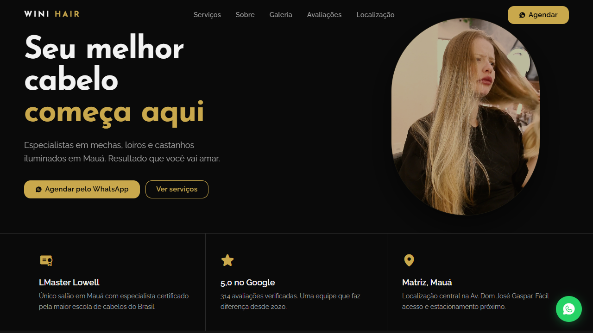

# Wini Hair – Site One-Page



Site institucional one-page do Salão de Beleza Wini Hair – by Willian Arroyo, Mauá – SP.

---

## Estrutura de arquivos

```
WiniHair/
├── index.html
├── 404.html
├── robots.txt
├── sitemap.xml
├── llms.txt
├── README.md
├── .gitignore
└── assets/
    ├── styles.css
    ├── app.js
    ├── tailwind-config.js
    └── img/
        ├── hero-poster.jpg
        ├── og-image.jpg
        ├── favicon.svg
        ├── equipe-01.jpg
        ├── HeroWA.mp4
        ├── hero-preview.png
        ├── servico-mechas.jpg
        ├── servico-coloracao.jpg
        ├── servico-escova.jpg
        ├── servico-manicure.jpg
        ├── servico-unhas-gel.jpg
        ├── servico-maquiagem.jpg
        ├── resultado-01.jpg
        ├── resultado-02.jpg
        ├── resultado-03.jpg
        ├── resultado-04.jpg
        ├── resultado-05.jpg
        └── resultado-06.jpg
```

---

## Seções

| # | Seção | Âncora |
|---|-------|--------|
| 1 | Navegação fixa | `#nav` |
| 2 | Hero (vídeo de fundo) | — |
| 3 | Diferenciais | `#diferenciais` |
| 4 | Serviços (tabs: Cabelos / Unhas / Eventos) | `#servicos` |
| 5 | Sobre o salão | `#sobre` |
| 6 | Galeria de resultados | `#galeria` |
| 7 | Avaliações do Google | `#avaliacoes` |
| 8 | Perguntas frequentes | `#faq` |
| 9 | Localização e horários | `#localizacao` |
| 10 | CTA final | `#contato` |
| 11 | Rodapé | — |

---

## Tecnologia

- **HTML / CSS / JS** puro — sem build, sem backend
- **Tailwind CSS** via CDN `@3` + config customizado em `assets/tailwind-config.js`
- **Phosphor Icons** web v2.1.1 (`src/regular/style.css` + `src/fill/style.css`)
- **Google Fonts**: Josefin Sans (400 / 600 / 700) + Raleway (400 / 500 / 600)
- **GoatCounter** (sem cookies) — eventos de CTA rastreados via listener único em `app.js`
- **JSON-LD**: `BeautySalon` + `FAQPage` schema

---

## Design tokens

```css
:root {
  /* Paleta */
  --bg:            #0a0a0a;
  --surface:       #141414;
  --surface-raised:#1e1e1e;
  --border:        #2a2a2a;
  --text:          #f2f2f2;
  --text-muted:    #a0a0a0;
  --accent:        #c9a84c;   /* gold */
  --accent-hover:  #dfc06a;

  /* Forma */
  --radius:        14px;
  --radius-sm:     8px;
  --radius-lg:     22px;

  /* Motion */
  --ease-expo:     cubic-bezier(0.16, 1, 0.3, 1);
  --transition:    0.3s cubic-bezier(0.16, 1, 0.3, 1);
}
```

Cores Tailwind extras (em `tailwind-config.js`):

```js
colors: {
  gold: { DEFAULT: '#c9a84c', light: '#dfc06a', dark: '#a07c2c' },
  surface: { DEFAULT: '#141414', raised: '#1e1e1e' },
  'wh-border': '#2a2a2a',
},
fontFamily: {
  display: ['"Josefin Sans"', 'sans-serif'],
  body:    ['Raleway', 'sans-serif'],
},
```

---

## Deploy e GoatCounter

### Deploy gratuito

Qualquer plataforma serve (nenhum build necessário):

| Plataforma | Passos |
|------------|--------|
| **Cloudflare Pages** | Conecte o repositório → framework: *None* → build: vazio → publish: `/` |
| **Netlify** | Arraste a pasta ou conecte o repo → publish directory: `/` |
| **GitHub Pages** | Settings → Pages → branch `main` → `/ (root)` |

Após o deploy, atualize `canonical`, `sitemap.xml` e o JSON-LD com o domínio final.

### Domínio próprio

Registre `winihair.com.br` (ou o domínio escolhido) e aponte os DNS para a plataforma de deploy. Depois, cadastre o domínio no Google Search Console e envie o `sitemap.xml`.

### GoatCounter

O script está no `<head>` de `index.html`:

```html
<script data-goatcounter="https://teocode.goatcounter.com/count"
        async src="//gc.zgo.at/count.js"></script>
```

**Eventos de CTA rastreados:**

| Evento | Localização |
|--------|-------------|
| `cta-nav` | Botão "Agendar" na nav desktop |
| `cta-nav-mobile` | Botão "Agendar" no menu mobile |
| `cta-hero` | CTA principal do hero |
| `cta-servicos` | Botão "Agendar" em cada card de serviço |
| `cta-sobre` | CTA na seção Sobre |
| `cta-localizacao` | CTA na seção Localização |
| `cta-contato` | CTA na seção de contato final |
| `cta-footer` | Link WhatsApp no rodapé |
| `cta-flutuante` | Botão flutuante verde (mobile) |

Para ver os dados: **GoatCounter dashboard → Events**.

> O domínio precisa estar cadastrado no painel do GoatCounter para registrar visitas de produção. Em desenvolvimento (localhost), os eventos são disparados mas podem não aparecer se o GoatCounter filtrar `localhost`.
